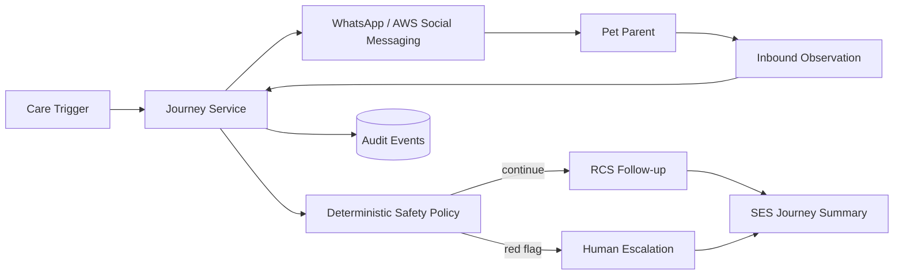

# CareLoop V1 Architecture

## Runtime evidence rule
Mocks are permitted only in tests. Submission evidence must demonstrate actual qualifying AWS CDS calls from the production adapters.

## Product boundary
CareLoop owns communication journeys. It does not diagnose, prescribe, replace VetThread, or become CAIOS infrastructure.
